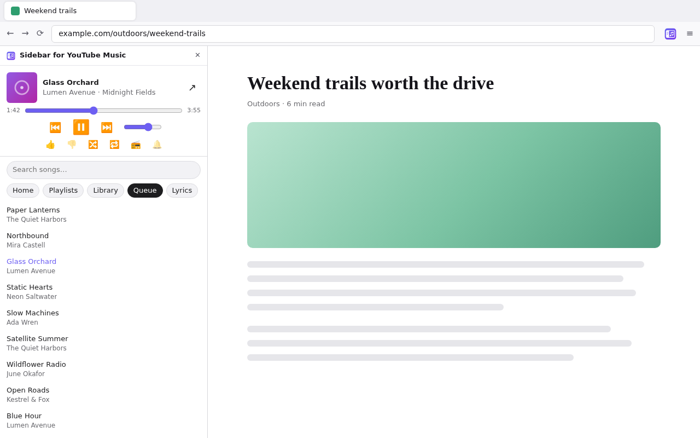
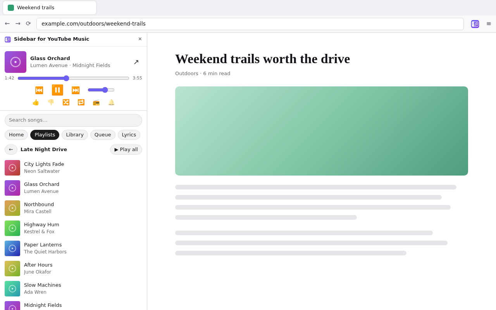
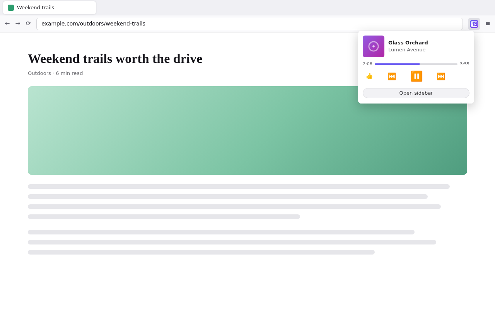
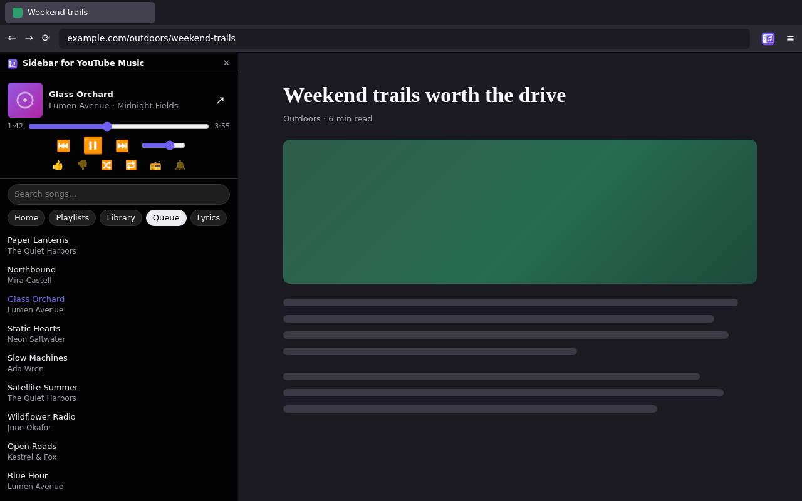

<p align="center">
  
</p>

<h1 align="center">Sidebar for YouTube Music</h1>

<p align="center">
  A YouTube Music remote in the Firefox sidebar and toolbar.<br />
  Your playlists, library, queue, search and lyrics, next to any page, with
  music that keeps playing when you close the sidebar.
</p>

<p align="center">
  <a href="https://addons.mozilla.org/firefox/addon/sidebar-for-youtube-music/"><b>Get it for Firefox</b></a>
  ·
  <a href="https://github.com/fabiosammy/ytmusic-sidebar-firefox/issues">Report a bug or suggest an idea</a>
</p>



## Features

- **Now playing** with artwork and progress; play/pause, next/previous,
  volume, like/dislike, shuffle, repeat and *start radio from this song*
- **Home**: quick picks, mixes and recommendations
- **Playlists** and **Library** (albums, artists, songs). Playlists and albums
  open to their songs with *Play all*; artists play their shuffle or radio
- **Queue**, **lyrics** of the current song and song **search**, with
  *Load more* on long lists
- **Toolbar popup** with the current song and controls, without opening the
  sidebar
- **Keeps playing** when you close the sidebar, and your keyboard's **media
  keys** work, even when Firefox is in the background
- Optional **notification** when a new song starts
- Follows Firefox's **light and dark** theme

| Playlist pages | Toolbar popup | Dark theme |
| --- | --- | --- |
|  |  |  |

## Getting started

1. Install the add-on from
   [Firefox Add-ons](https://addons.mozilla.org/firefox/addon/sidebar-for-youtube-music/).
2. Sign in at [music.youtube.com](https://music.youtube.com) (a free account
   works).
3. Open the sidebar with `Alt+Shift+M`, or click the toolbar icon →
   **Open sidebar**. Click **Allow access to YouTube Music** if asked.
4. Pick a playlist, an album or a search result.

### If music doesn't start

The add-on plays music in a hidden YouTube Music tab, and Firefox blocks
audio that starts without a click. Allow it once for YouTube Music:

1. Open music.youtube.com, press `Ctrl+I` (Page Info) → **Permissions** →
   **Autoplay**: untick *Use Default*, choose **Allow Audio and Video**.
2. If it still doesn't start: `about:config` →
   `media.block-autoplay-until-in-foreground` → `false`. This one applies to
   every site, so tabs you haven't looked at yet may start their own audio.

### Good to know

- The **↗** button shows the hidden player tab with the full YouTube Music
  page. It hides itself again when you switch to another tab.
- On free accounts, Next/Previous are disabled during ads. That is YouTube
  Music's rule, not the add-on's.
- Signed out? The sidebar tells you and offers **Sign in**; once you sign in
  in any YouTube Music tab, the player picks it up by itself.

## Privacy and permissions

The add-on collects no data and talks to no server other than
music.youtube.com, the same way the YouTube Music page itself does.

| Permission | Why |
| --- | --- |
| Access to music.youtube.com | To run the player script in the YouTube Music tab |
| Hide tabs | To keep the one player tab out of your tab bar |
| Storage | To remember which tab is the player and your notification setting |
| Notifications | For the optional "now playing" notification |

## Contributing

Bug reports, ideas and pull requests are welcome. Please open an
[issue](https://github.com/fabiosammy/ytmusic-sidebar-firefox/issues) first for
bigger changes.

### Development setup

Requires Node.js 24 and Firefox 142 or newer.

```bash
npm install
npm run lint      # Mozilla's add-on linter
npm run package   # zip in web-ext-artifacts/
npm start         # throwaway Firefox profile with the add-on on music.youtube.com
```

To try it in your own Firefox: `about:debugging#/runtime/this-firefox` →
**Load Temporary Add-on…** → pick `manifest.json`. Temporary add-ons are
removed when Firefox restarts.

Every pull request runs [10 · Validate](.github/workflows/10-validate.yml):
the linter, a version check and a package build. The built zip is attached to
the run, so anyone can try a pull request.

### How it works

Music only ever plays in **one hidden YouTube Music tab** that the add-on
opens. The sidebar and the popup are remotes for it, so there is never a
second player, playback survives closing the sidebar, and Firefox treats the
media keys like for any tab.

| File | Role |
| --- | --- |
| `src/background.js` | Creates and remembers the hidden player tab (`tabs.hide`, id in `storage.session`) and relays sidebar and popup requests to it |
| `src/player.js` | Content script in YouTube Music: reads the player, presses its buttons, reads the queue, and calls YouTube Music's own web API (innertube, as the page does) for home, playlists, library, search and lyrics |
| `src/sidebar.*` | The sidebar remote; polls the player once a second |
| `src/popup.*` | The toolbar popup |
| `src/common.js` | Helpers shared by the sidebar and the popup |

YouTube Music has no public API, so `src/player.js` depends on its page
structure and internal API responses. When Google changes them, that is
usually the file to fix.

The screenshots above are rendered from mock pages that use the add-on's real
CSS with made-up songs: `store/screenshots/render.sh <path-to-chrome-headless-shell>`.

## License

[MIT](LICENSE)

Sidebar for YouTube Music is an independent project. It is not affiliated
with, endorsed by or sponsored by Google LLC or YouTube. YouTube and YouTube
Music are trademarks of Google LLC.
